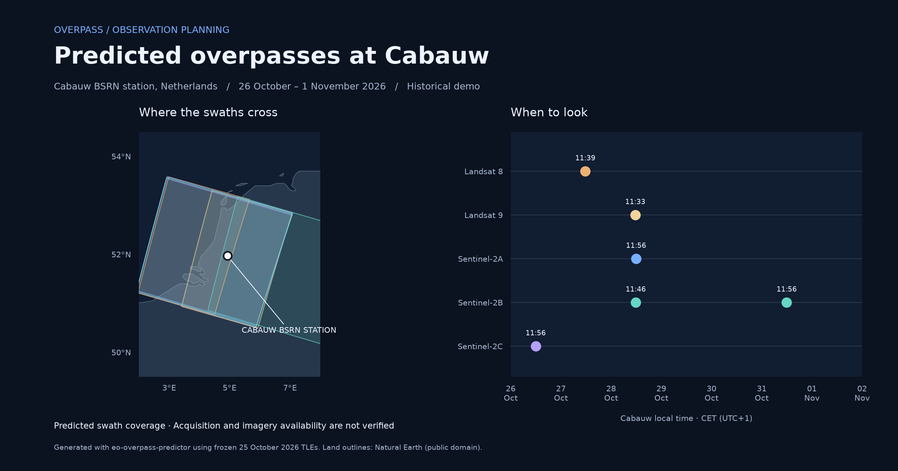
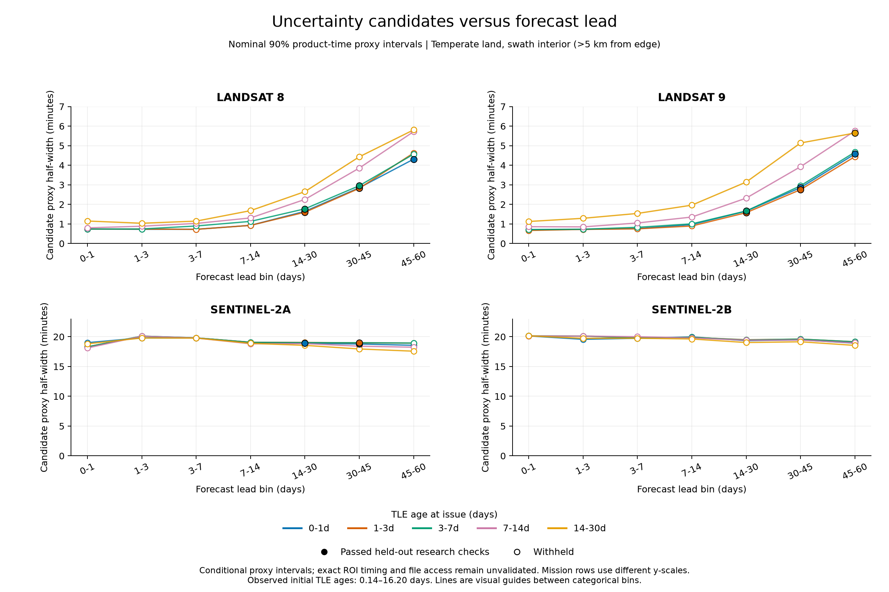

<p align="center">
  
</p>

<h1 align="center">EO Overpass Predictor</h1>

<p align="center">
  Plan Landsat and Sentinel observations from your browser, terminal, or Python.
</p>

<p align="center">
  <a href="https://overpass.hyperalislabs.com"><strong>Open the web planner</strong></a>
  · <a href="docs/cli.md">CLI guide</a>
  · <a href="docs/api.md">Python API</a>
  · <a href="website/README.md">Website documentation</a>
</p>

<p align="center">
  <a href="pyproject.toml"></a>
  <a href="LICENSE"></a>
</p>

Find out **when Landsat and Sentinel satellites will cover your area**, compare
upcoming passes, and take the results into your own workflow. Use the web planner,
run a quick terminal forecast, or build predictions into Python.

Built on **Julian Manning's original scientific implementation**; see
[credits and citation](#credits-citation-and-license).



*Generated for our [Cabauw example point](examples/data/cabauw_netherlands.geojson)
using frozen orbital data for 26 October–1 November 2026. This historical
example shows predicted swath coverage.*

## What you can do

- **Plan observations for your area.** Select a point, draw a region, or bring your
  own boundary file. See which passes cover it and when they arrive in local time.
- **Compare optical and radar opportunities.** Explore Landsat 8/9,
  Sentinel-2A/B/C, and Sentinel-1C/D, with coverage and daylight filters.
- **Explore passes visually.** Inspect footprints, browse a timeline, and follow
  estimated satellite positions on a map or globe.
- **Check Sentinel acquisition plans.** Use the CLI or Python API to compare
  predictions with ESA plans when available.
- **Share and reuse results.** Export tables, geographic data, or an interactive
  HTML planner, and connect the package to scripts and notebooks.

## Try the web planner

**[Open Overpass →](https://overpass.hyperalislabs.com)**

Draw your area, choose satellites and dates, and explore the results on a 2D map
or 3D globe. Select a pass to inspect its footprint, compare coverage in the
results table, and download your selection.

The prediction package runs in your browser. Your regions and results stay there;
map tiles and orbital data need network access. The first run can take a little
longer while the Python environment loads. ESA plan checks are available through
the CLI and Python API.

## See your observation window

Compare opportunities across missions, then export an interactive HTML report to
inspect individual passes and footprints. Reports are snapshots: refresh them as
orbital data age or the prediction window expires.

## Explore historical performance

The generated benchmark plots show how timing comparisons change with the age of
orbital data and how far ahead a prediction is made.



*Looking further ahead: Landsat timing ranges generally widen with longer
forecasts. Filled markers passed the study's research checks; open markers are
withheld. The missions use different vertical scales.*

These historical comparisons use product timestamps and catalogue matches.
Exact timing at the target and usable imagery remain unvalidated.
Sentinel-2 timestamp differences need further study.

See [the results and how to read them](docs/uncertainty.md) for the study's scope,
validation status, and reproducible data, or the
[benchmark documentation](benchmark/README.md) for the full methodology.

## Get started locally

Requires **Python 3.11+** and [uv](https://docs.astral.sh/uv/). Install this fork
from a checkout:

```bash
git clone https://github.com/simon-donike/eo-overpass-predictor.git
cd eo-overpass-predictor
uv sync
```

### Command line

Find passes for a point over the next 14 days, or export a Sentinel planner:

```bash
uv run eo-overpass next --point 144.96 -37.82
uv run eo-overpass next --point 144.96 -37.82 --satellite S1 S2 --output planner.html
```

Coordinates are **longitude, latitude**. You can also use a bounding box or a
region file, choose dates and coverage filters, and request JSON for automation.
See the [CLI guide](docs/cli.md) for options and examples.

### Python

```python
from eo_overpass_predictor import fetch_tles, load_roi, predict_overpasses

roi = load_roi((144.35, -38.35, 145.15, -37.80), name="Port_Phillip_Bay")
tles = fetch_tles(satellites=["S1", "S2"])
passes = predict_overpasses(roi, tles, days=7)
print(passes)
```

Retrieving orbital data is explicit; the prediction function calculates from the
inputs you supply. See the [Python API](docs/api.md) and
[runnable examples](examples/) for exports, offline use, and integration.

### Notebooks

```bash
uv sync --extra notebooks
uv run --extra notebooks jupyter lab
```

Open the [prediction notebook](notebooks/p01_overpass_prediction.ipynb) for maps
and timelines, or the [live tracker](notebooks/p02_overpass_live_tracker.ipynb)
to explore satellite motion.

## Reading a forecast

A predicted pass means the modeled imaging swath intersects your area. It does
not guarantee an acquisition or cloud-free imagery. Missing ESA plans mean
acquisition is **unknown**; Landsat acquisition is **not checked**. Even a planned
acquisition, including a non-nominal plan, may not produce imagery. The package
does not check imagery availability.

Use fresh orbital data near your chosen dates. The 7/14-day freshness labels flag
when to refresh the data; they provide no accuracy probability. Allow for uncertainty near swath
edges (approximately ±5 km), and take extra care with very large, polar, or
antimeridian-spanning regions. Sentinel-1 uses nominal radar geometry.

## Documentation

| For… | Read… |
|---|---|
| Commands, filters, exports, and offline use | [CLI guide](docs/cli.md) |
| Python workflows and integration | [API reference](docs/api.md) |
| Browser setup, privacy, and development | [Website guide](website/README.md) |
| Scientific method and original examples | [Original notebook workflow](docs/original-notebook-workflow.md) |
| Historical performance and limitations | [Uncertainty plots](docs/uncertainty.md) · [Benchmark](benchmark/README.md) |
| Contributing, checks, and releases | [Repository conventions](AGENTS.md) · [Release guide](docs/releasing.md) |

## Credits, citation, and license

**Julian Manning** created the original scientific implementation and notebooks,
including the orbital propagation, optical swath geometry, and original reporting
methodology. See his
[original repository](https://github.com/julianManning/eo-overpass-predictor) and
[ORCID](https://orcid.org/0000-0003-4481-5474).

**Original DOI:** [10.5281/zenodo.23629976](https://doi.org/10.5281/zenodo.23629976).
This identifies **Julian Manning's original 1.0.0 release**.
Use [CITATION.cff](CITATION.cff) to cite that original scientific software.

This fork builds on Julian's work with an installable Python package, CLI,
browser planner, Sentinel-1 support, and expanded data handling and tests.

Released under the [MIT license](LICENSE), retaining Julian Manning's original
copyright notice. Orbital elements come from [CelesTrak](https://celestrak.org/);
acquisition plans are © ESA. Maps use attributed OpenStreetMap data and
public-domain Natural Earth coastlines. See the
[website documentation](website/README.md) for further third-party attribution.
