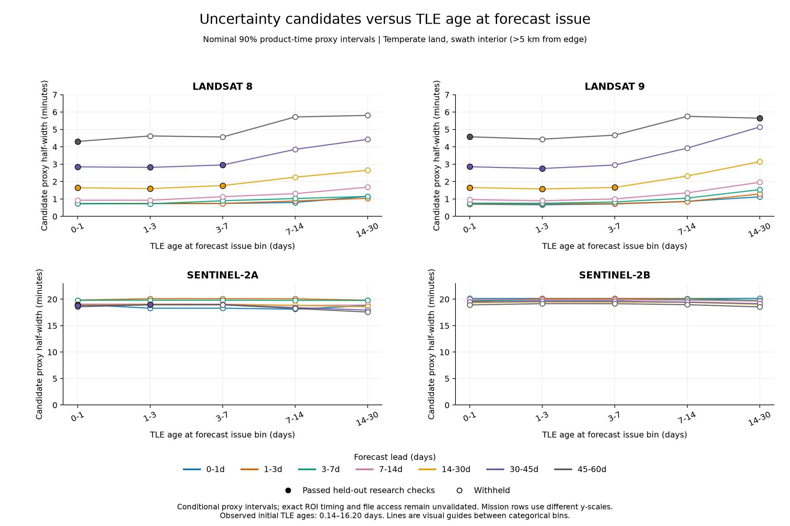
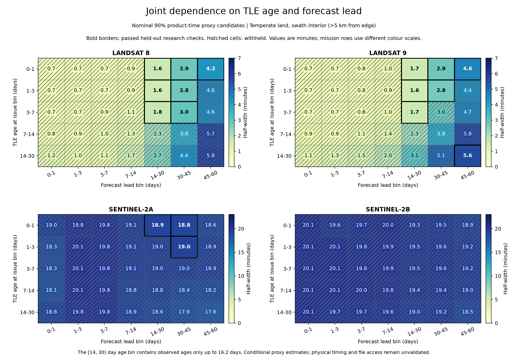

# Historical uncertainty: TLE age and forecast lead

The completed historical benchmark provides **conditional product-time proxy
intervals** as a function of TLE age and forecast lead. Filled markers below
identify strata whose candidate passed the saved research validation checks;
open markers and hatched cells identify withheld candidates.

These figures use the saved observations, not regression fixtures. All matched
times in this study were padded product timestamps. Exact sensing time at the
target point and readable image-file availability remain unvalidated. The
intervals therefore do not establish physical orbital accuracy, positional
accuracy, or a probability of receiving usable imagery.

## What the axes and uncertainty mean

- **Initial TLE age:** forecast issue time minus the original TLE epoch. It is
  independent of when the historical archive was downloaded.
- **Forecast lead:** time from forecast issue to the predicted pass, within the
  frozen 60-day forecast window. Elements were not updated during that window.
- **TLE age at the pass:** initial TLE age plus forecast lead.
- **Plotted half-width:** the calibration candidate for a nominal 90% symmetric
  interval around the predicted time, conditional on a unique catalogue match.
  A half-width of 2 minutes means prediction time **±2 minutes**. It is the
  90th percentile of the largest absolute endpoint discrepancy against the
  padded product-time interval, not a standard deviation or a confidence interval
  for the mean.

Timestamps were padded by 30 seconds for Landsat and 300 seconds for Sentinel-2;
nearby products can merge into longer local proxy events. The half-width includes
these proxy conventions. A missing catalogue match has no measured timing error
and does not enter the conditional timing quantile.

All panels hold **temperate latitude, land and swath interior** fixed; interior
means more than 5 km from the modeled swath edge. This avoids pooling geographic
and edge strata into the same age/lead comparison. The page displays 140 strata,
17 of which passed. The complete global analysis had 1,667 strata, 18 of which
passed; the additional passing stratum was tropical Sentinel-2A land/interior.
These views do not validate ocean, polar, tropical or swath-edge predictions.

The bins are categorical. Lines guide the eye between bin estimates and do not
define an interpolated uncertainty model. Age bins are `[0,1)`, `[1,3)`, `[3,7)`,
`[7,14)` and `[14,30)` days, but actual initial ages spanned only **0.140–16.200
days**. In particular, the last label does not establish support through 30 days.
The CSV records each stratum's observed minimum and maximum age. Forecast lead
bins span 0–60 days. Landsat and Sentinel-2 use different vertical/colour scales
to retain visible detail; compare axis labels when comparing missions.

## Uncertainty versus TLE age

Each line fixes a forecast-lead bin. The horizontal axis changes the age of the
TLE available when the prediction was issued.



[Download SVG](assets/uncertainty/versus-tle-age.svg).

## Uncertainty versus prediction timespan

Each line fixes an initial TLE-age bin. The horizontal axis changes the lead to
the predicted pass within the forecast window.


[Download SVG](assets/uncertainty/versus-forecast-lead.svg).

Landsat candidates generally widen with lead and with older starting elements.
For initial ages below one day, the passing temperate-land/interior candidates
illustrate the lead dependence:

| Platform | Forecast lead | Candidate half-width | Held-out coverage | 95% bootstrap coverage interval |
|---|---|---:|---:|---:|
| Landsat 8 | 14–30 days | ±98.7 s | 96.1% | 88.9–100.0% |
| Landsat 8 | 45–60 days | ±258.7 s | 96.0% | 85.6–100.0% |
| Landsat 9 | 14–30 days | ±99.5 s | 97.3% | 90.9–100.0% |
| Landsat 9 | 45–60 days | ±274.6 s | 98.0% | 92.0–100.0% |

These are conditional proxy results for the stated strata and observed age
ranges. Their coverage percentages do not describe all forecast passes.
Sentinel-2 has large proxy discrepancies even with recent TLEs and short leads;
product timestamp conventions and mission regimes need investigation before
attributing those discrepancies to TLE propagation error. Sentinel-2B had no
candidate passing the full research checks in the complete study.

## Joint dependence

This view exposes the age/lead combinations directly. Numbers are candidate
half-widths in minutes. Bold borders mark passing strata; hatching marks
withheld candidates, even where the estimated width is small.



[Download SVG](assets/uncertainty/age-and-lead.svg).

## Validation and limits on confidence scores

The full run completed 97,920 cases: 288 global point sites, 17 issue dates, four
platforms and five element-cutoff cohorts. Actual element ages determine the
plotted age bands, not the nominal 0/1/3/7/14-day cutoff delays. As-of element
availability uses the IAU archive's collection timestamp as a conservative
observed-by upper bound, not the publisher's exact release time.

The first 11 dates, September 2023–June 2025, calibrated the candidate intervals.
The last six dates, August 2025–June 2026, tested them without refitting. The saved
analysis used 1,000 crossed bootstrap replicates over complete issue dates and
spatial cells. Repeated passes and TLE cohorts are not independent trials.
Identical orbital-input forecasts were deduplicated before calibration.

A candidate passed only when both splits met the prespecified support gates:
at least 10 calibration dates and 6 holdout dates **with matches**, at least
20 spatial blocks with matches and 200 matches in each split, at most 5% unknown
evidence, and complete cases in the satellite/surface domain. The held-out
95% bootstrap lower coverage bound had to reach 85% for the nominal 90% interval;
degenerate coverage bootstraps were withheld. The 5-percentage-point tolerance
does not establish a guaranteed 90% coverage rate.

A small half-width can still be withheld because support is sparse. These are
pointwise research checks across many strata, without a simultaneous or
distribution-free coverage guarantee. The validation reuses the sampled sites
on later dates, so transfer to other geographic populations is not independently
tested. Future manoeuvres and acquisition-policy changes can change performance.

Only events compatible with the platform/direction and within the finite
30-minute matching gate were identifiable as matches. Missing acquisitions and
larger timing discrepancies remain outside the measured conditional timing
distribution. Catalogue presence, expected imaging, acquisition plans, readable
files and cloud-free pixels remain separate outcomes. Catalogue queries captured
on 26 October 2026 UTC establish eventual presence at that time, not historical
delivery latency. No matched image file was verified as readable in this run.

The [benchmark methodology](../benchmark/README.md) describes these estimands,
matching rules and limitations in full. The production 7/14-day TLE freshness
labels remain refresh reminders; these plots do not convert them into accuracy
probabilities. Julian Manning's propagation and optical swath implementation
supplied the predictions without scientific changes.

## Data and reproduction

The committed [plot data](data/uncertainty-20261026.csv) contain the 140 displayed
strata, exact candidate widths in seconds, validation status, withholding reasons,
observed TLE-age ranges, split counts and held-out coverage intervals. The
[provenance record](data/uncertainty-20261026.provenance.json) records source hashes,
the complete design and split, and study ID
`22ff17e444ad53302328d99a523e5af4c1e31dca6d20585d524e7838217454f8`.
This documentation snapshot is observational evidence, not a regression baseline
or an installed production calibration.

Reproduce all PNG and SVG figures offline from the committed snapshot:

```bash
uv sync --all-extras
uv run python docs/plot_uncertainty.py
```

To refresh that snapshot from the existing full local run:

```bash
uv run python docs/plot_uncertainty.py \
  --run benchmark/runs/historical-20261026-age-v2
```

The full reports and evidence remain in that ignored local run directory. The
plotting command reads saved summaries and does not propagate, collect imagery,
rerun calibration, or change validation decisions.
